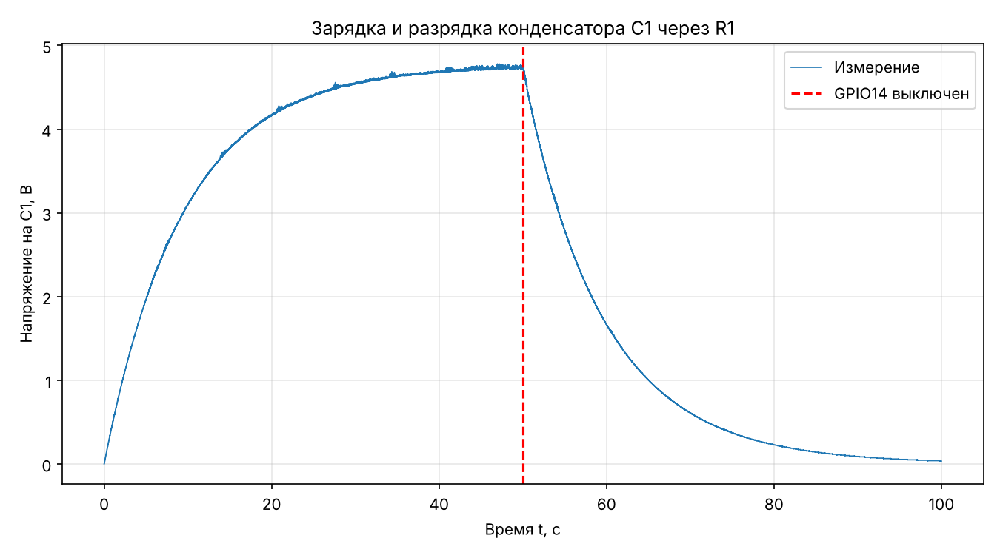
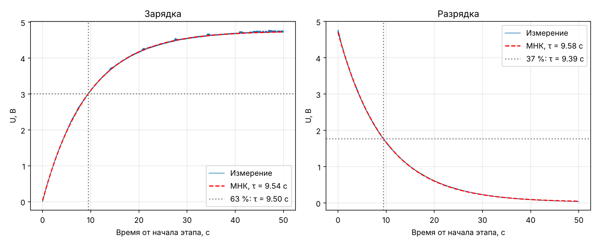
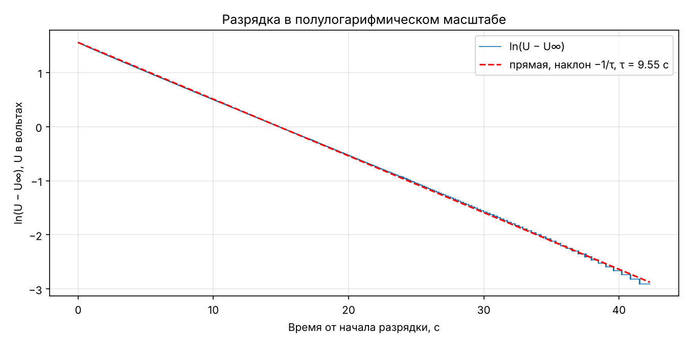

# Цель работы

1. Снять зависимость напряжения на конденсаторе от времени при зарядке и разрядке RC-цепи.
2. По полученным графикам определить постоянную времени цепи τ.
3. Сравнить измеренное значение τ с номинальным τ = R·C, рассчитанным по маркировке резистора и конденсатора.

# Теоретические сведения

При зарядке конденсатора ёмкостью C через резистор R от источника с ЭДС E напряжение на конденсаторе растёт по закону

> *U*(*t*) = *E*·(1 − e^−*t*/τ^),

а при разрядке через тот же резистор (источник отключён) спадает по закону

> *U*(*t*) = *U*~0~·e^−*t*/τ^,

где τ = *RC* — постоянная времени цепи.

За время *t* = τ при зарядке напряжение достигает 1 − e^−1^ ≈ 63 % от установившегося значения, а при разрядке падает до e^−1^ ≈ 37 % от начального. На этом основан простейший графический способ определения τ. Другой способ — построить зависимость ln *U* от *t* при разрядке: она линейна, а её наклон равен −1/τ.

# Оборудование

- Микрокомпьютер Raspberry Pi; выход GPIO14 управляет зарядкой RC-цепи (1 — зарядка, 0 — разрядка).
- 10-битный АЦП MCP3021 на шине I²C (адрес 0x4D), динамический диапазон 5,186 В, цена младшего разряда ≈ 5,1 мВ.
- Плата AUX с RC-цепью. Номиналы элементов определены по маркировке:

| Элемент | Маркировка | Номинал | Допуск |
|---|---|---|---|
| R1 (выводной) | коричневый, чёрный, зелёный, золотой* | 1 МОм | ±5 % |
| C1 (электролитический) | 10 мкФ | 10 мкФ | ±20 % (типично для электролитических) |
| R2 (SMD) | 1000 | 100 Ом | ±1 % |
| R3 (SMD) | 5600 | 560 Ом | ±1 % |

\* Четвёртая полоса на фото выглядит жёлтой; для четырёхполосной маркировки это, скорее всего, золотая полоса (±5 %).

R3 — токоограничивающий резистор светодиода питания V1, R2 стоит в цепи кнопки. В этом опыте кнопка не нажималась, поэтому постоянную времени определяют только R1 и C1.

Номинальная постоянная времени:

> τ~ном~ = *R*~1~·*C*~1~ = 1 МОм · 10 мкФ = 10 с.

С учётом допусков δτ~ном~ = √(5² + 20²) % ≈ 21 %, то есть τ~ном~ = (10 ± 2,1) с.

# Методика измерений

Измерения проводились программой `RC_.py`:

1. Выход GPIO14 = 0 в течение 50 с, чтобы конденсатор полностью разрядился.
2. GPIO14 = 1 на 50 с (зарядка, ≈ 5τ), всё это время напряжение непрерывно считывается АЦП.
3. GPIO14 = 0 ещё на 50 с (разрядка), измерения продолжаются.
4. Время, напряжение и состояние выхода сохраняются в файл `lab.csv`.

Всего получено 181 651 измерение за 100 с, средняя частота измерений ≈ 1816 Гц.

Обработка выполнена программой `RC_analysis.py` четырьмя способами:

- по уровню 63 % на зарядке;
- по уровню 37 % на разрядке;
- методом наименьших квадратов (МНК) по модели *U* = *A* + *B*·e^−*t*/τ^ отдельно для зарядки и для разрядки.

# Результаты

{width=16cm}

{width=16cm}

{width=16cm}

Установившееся напряжение при зарядке *U*~∞~ ≈ 4,75 В. В конце разрядки напряжение опустилось до 0,035 В. Среднеквадратичное отклонение точек от аппроксимирующей экспоненты — 8–9 мВ, это порядка 2 единиц младшего разряда АЦП.

| Способ определения | τ, с |
|---|---|
| Уровень 63 %, зарядка | 9,50 |
| Уровень 37 %, разрядка | 9,39 |
| МНК, зарядка | 9,54 |
| МНК, разрядка | 9,58 |
| Линеаризация ln U(t), разрядка (рис. 3) | 9,55 |
| **Среднее по первым четырём способам** | **9,50 ± 0,08** |

Погрешность среднего оценена по разбросу значений, полученных разными способами.

# Сравнение с номиналом

| Величина | Номинал | Эксперимент |
|---|---|---|
| τ, с | 10 ± 2,1 | 9,50 ± 0,08 |
| R при C = 10 мкФ | 1 МОм | 0,95 МОм |
| C при R = 1 МОм | 10 мкФ | 9,5 мкФ |

Измеренная постоянная времени на 5 % меньше номинальной. Это отличие лежит внутри допуска номиналов (±21 %), который в основном определяется большим разбросом ёмкости электролитических конденсаторов.

Значения τ, полученные при зарядке и разрядке, совпадают с точностью около 1 %. Значит, цепь заряжается и разряжается через одно и то же сопротивление и хорошо описывается моделью RC-цепи.

Возможные причины отличия от номинала:

- реальная ёмкость конденсатора и сопротивление резистора отличаются от номинальных в пределах допусков;
- ток утечки электролитического конденсатора и входное сопротивление АЦП действуют как большое сопротивление, подключённое параллельно конденсатору. Оно уменьшает эффективную постоянную времени и не даёт конденсатору зарядиться до полного напряжения питания. С этим согласуется то, что установившееся напряжение 4,75 В ниже диапазона АЦП 5,19 В.

# Вывод

В работе сняты кривые зарядки и разрядки RC-цепи с R1 = 1 МОм и C1 = 10 мкФ. Обе кривые хорошо описываются экспонентой. Постоянная времени, найденная четырьмя способами, равна τ = (9,50 ± 0,08) с. Это на 5 % меньше номинального значения τ = RC = 10 с и согласуется с ним в пределах допусков элементов.

# Приложение

Файлы в папке `Пайка` репозитория:

- `RC_.py` — управление GPIO14, измерение и сохранение данных;
- `RC_analysis.py` — обработка данных и построение графиков;
- `mcp3021_driver.py` — драйвер АЦП MCP3021;
- `lab.csv` — исходные данные (время, напряжение, состояние GPIO14).
